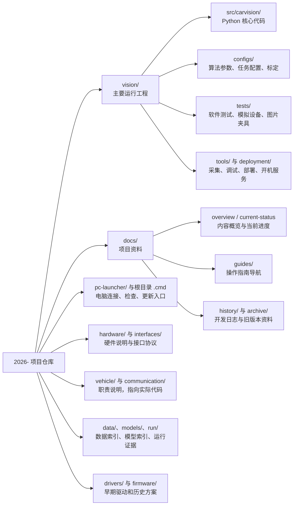
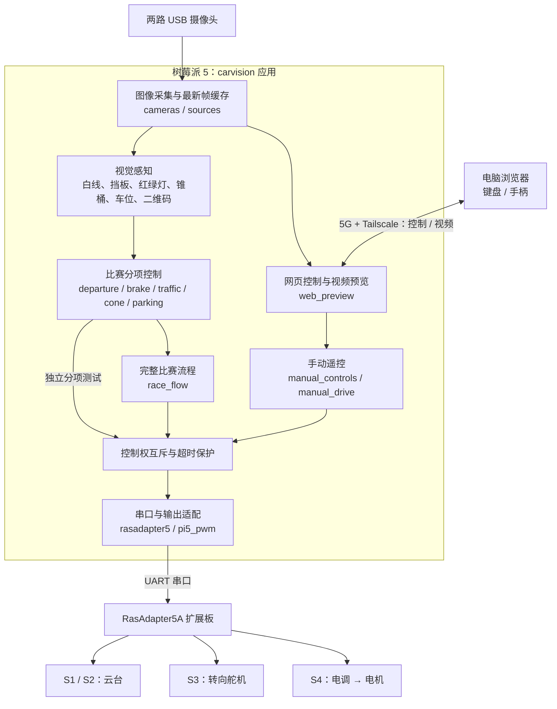

# 2026 室外 5G 远程驾驶无人车

基于 **Raspberry Pi 5 + RasAdapter5A 串口扩展板 + 双 USB 摄像头**的比赛项目，包含 5G 网页遥控、视觉感知、分项测试与完整比赛流程。当前不使用独立 STM32，不依赖 ROS。

**从 [项目内容概览](docs/overview.md) 开始。** 概览介绍各项功能、代码位置和完成程度；[当前进度](docs/current-status.md) 区分主线代码、历史部署与待验收项。完整自主赛道和停车入位尚未通过实车验收。

## 最新代码从这里获取

**日常开发统一使用 `main` 主分支。** 这里的“最新代码”指最新已合并代码；尚未合并的任务分支单独保留。

| 用途 | 明确入口 |
| --- | --- |
| 浏览最新已合并源码 | [main 主分支](https://github.com/zxjzzbh/2026-/tree/main) |
| 下载随主线更新的完整源码 | [下载 main ZIP](https://github.com/zxjzzbh/2026-/archive/refs/heads/main.zip) |
| 获取本次固定版本 | [2026-10-20 源码发布页](https://github.com/zxjzzbh/2026-/releases/tag/source-2026-10-20) · [源码包 ZIP](https://github.com/zxjzzbh/2026-/releases/download/source-2026-10-20/smartcar-source-20261020.zip) |
| 核对包含内容、版本和安装步骤 | [最新代码说明](docs/latest-code.md) |

本次固定版本标签为 **`source-2026-10-20`**，包含 PR #7 合并后的完整主线、两张结构图和整理后的文档。10 月 20 日仍未合并的 [停车路径 PR #6](https://github.com/zxjzzbh/2026-/pull/6) 不包含在此快照中。源码已合并不表示已部署到小车或通过全程实车验收。

首次获取：

```sh
git clone --branch main https://github.com/zxjzzbh/2026-.git
cd 2026-
git log -1 --oneline
```

已有工作目录先检查 `git status`，在保存本地修改后执行 `git switch main`、`git pull --ff-only origin main`。不需要复制一份“最新代码”子目录；源码包由同一 Git 版本生成。

## 按需求查找

| 我要做什么 | 入口 |
| --- | --- |
| 获取明确的最新主线或固定源码包 | [最新代码说明](docs/latest-code.md) |
| 了解项目有哪些内容 | [内容概览](docs/overview.md) |
| 找代码、配置、工具或资料 | [目录与维护约定](docs/repository-structure.md) |
| 连接小车、测试一个比赛任务 | [操作指南导航](docs/guides/README.md) |
| 查看已完成内容和下一步 | [当前进度](docs/current-status.md) |
| 在新电脑安装并做离线检查 | [安装与复现](docs/reproduce.md) |
| 理解数据流、硬件和接口 | [系统架构](docs/architecture.md) · [硬件](hardware/README.md) · [接口](interfaces/README.md) |
| 参与开发和提交代码 | [贡献指南](CONTRIBUTING.md) · [团队分工](docs/team.md) |
| 追溯旧版本与部署记录 | [历史记录](docs/history/README.md) · [源码包归档](docs/archive/README.md) · [分支说明](docs/branches.md) |

## 仓库结构

实际运行代码集中在 **`vision/src/carvision/`**，其中包含视觉、遥控、比赛流程和硬件控制。`vehicle/`、`communication/` 等目录主要提供职责说明。下图按用途归组，完整目录职责见 [目录说明](docs/repository-structure.md)。



根目录的 `.cmd` 是兼容现有操作习惯的快捷入口；`SOURCE-MANIFEST.json` 与 `source-snapshot.json` 是历史来源清单。各目录的准确职责见 [目录说明](docs/repository-structure.md)。

## 小车运行时如何配合

图中树莓派内的软件主要位于 `carvision` 包，包含独立分项测试和完整比赛两种任务组织方式。



`race.py` 和 `autonomy_*` 另外提供米制观测、运动规划与离线回放框架；真实反馈、运动标定和实车验收情况见 [当前进度](docs/current-status.md)。

## 比赛任务

5G 远程驾驶 → 换区停稳并手动切换 → 蓝挡板移开 → 自主循迹 → 斑马线停车播报 → 红绿灯 → 两桶避障 → 空闲半区停车 → 队员扫码缴费。

单项测试与完整流程的行为有区别，例如红绿灯单测在绿灯确认后只播报，完整流程才继续下一阶段。详见 [任务指南](docs/guides/README.md) 和 [规则记录](docs/rules/README.md)。

## 电脑离线检查

推荐 Python 3.12；浏览器逻辑测试需要 Node.js，CI 使用 Node.js 22。从仓库根目录执行：

```sh
python -m venv .venv
# Windows PowerShell:
.venv/Scripts/Activate.ps1
# Linux 使用：source .venv/bin/activate
python -m pip install -e "vision[test]"
python -m pytest vision/tests -q -ra
python -m carvision autonomy-check --profile vision/configs/autonomy-pi5.json
```

这些是软件检查。当前自主配置仍有未完成标定项；离线检查或模拟完成不等于实车完赛。更多回放命令见 [复现说明](docs/reproduce.md)。

公开仓库保留源码、可公开配置和小型测试夹具；个人凭据、大录像、模型权重与大部分运行日志通过本地配置或索引管理。团队尚未选择整体开源许可证，第三方源码保留各自许可证。
