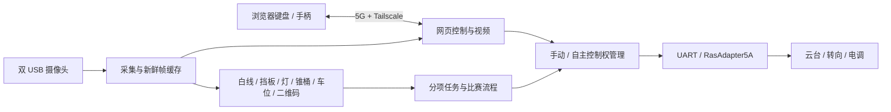

# 项目内容概览

整理日期：2026-10-20；依据主线 `cdf8d31` 及仓库内记录。本文介绍仓库内容，部署和验收进度统一维护在 [当前进度](current-status.md)。

## 项目做什么

项目面向室外 5G 远程驾驶无人车比赛。操作者先通过浏览器远程驾驶，到切换区停稳后接入自主任务。车辆利用双摄图像识别道路与比赛元素，通过串口扩展板控制转向和电调，最后由队员完成扫码缴费。

硬件链路是 Raspberry Pi 5 → UART → RasAdapter5A → S1/S2 云台、S3 转向、S4 ESC。视频与网页控制经 5G/Tailscale 传输。实际程序集中在 `vision/src/carvision/`，所以这里的 `vision` 已包含整车应用，不只是视觉算法。

这个图描述代码职责；真实速度、位姿与制动反馈仍有待接通或验收的部分。

## 功能与代码对应关系

下表的文件名均相对 [vision/src/carvision/](../vision/src/carvision/)。通配名称表示同一功能的一组文件。

| 内容 | 仓库里已有的内容 | 主要代码 | 使用说明 |
| --- | --- | --- | --- |
| 相机与预览 | 双摄选择、图像/录像输入、原图与识别图、MJPEG | `sources.py`、`cameras.py`、`web_preview.py`、`camera_assistance.py` | [预览](../vision/LIVE_PREVIEW.md) |
| 5G 遥控 | 开机等待、键盘/手柄、控制会话、心跳、急停 | `boot_test.py`、`manual_controls.py`、`manual_drive.py`、`gamepad_controls.py` | [连接](../vision/CONSOLE_ACCESS.md)、[开机](../vision/BOOT_TEST.md) |
| 白线循迹 | 基础循迹、锥桶场景双白线内边界与纠偏 | `lane.py`、`cone_boundaries.py`、`cone_road.py` | [循迹与锥桶](../vision/CONE_TEST.md) |
| 蓝挡板发车 | 确认挡板存在、移开及播报；接入总流程 | `departure.py`、`departure_trial.py`、`departure_controls.py` | [发车测试](../vision/DEPARTURE_TEST.md) |
| 斑马线停车 | 图像参考、F/B 有限制动、停稳观察与语音 | `crosswalk.py`、`brake_parking.py`、`brake_trial.py`、`brake_output.py` | [主动制动](../vision/BRAKE_PARKING.md) |
| 红绿灯 | 双路灯色识别、时间窗确认、停车/绿灯播报 | `traffic_signal.py`、`traffic_voting.py`、`traffic_driving.py`、`traffic_trial.py` | [红绿灯测试](../vision/TRAFFIC_SIGNAL.md) |
| 锥桶避障 | 目标识别与跟踪、连续低速引导、转向平滑 | `cone_vision.py`、`cone_continuous.py`、`cone_low_speed.py`、`cone_navigation.py` | [锥桶说明](../vision/CONE_TEST.md) |
| 停车区 | 空闲侧建议、可见边界跟踪、独立低速入位试验 | `parking_bay.py`、`parking_guidance.py`、`parking_entry.py`、`parking_entry_run.py` | [停车说明](../vision/PARKING_BAY.md) |
| 扫码缴费 | 二维码观察、图片保留、倒计时与人工回执 | `parking_payment.py`、`payment_console.py`、`payment_controls.py` | [缴费说明](../vision/PARKING_PAYMENT.md) |
| 完整流程 | 挡板→斑马线→红绿灯→锥桶→停车→缴费 | `race_flow.py`、`race_flow_camera.py`、`race_flow_controls.py`、`race_flow_console.py` | [流程说明](../vision/RACE_FLOW.md) |
| 自主框架 | 版本化观测、米制几何、运动门控、离线回放 | `race.py`、`autonomy_*.py`、`ground_odometry.py`、`parking_mission.py` | [自主框架](../vision/AUTONOMY_PI5.md) |
| 执行与播报 | UART/CRC8、受限输出、转向常量、音频后端 | `rasadapter5.py`、`pi5_pwm.py`、`steering.py`、`autonomy_audio.py` | [硬件](../hardware/README.md)、[接口](../interfaces/README.md) |
| 数据与模型 | 采集标注、传统图像处理、可选 YOLO/ONNX 流程 | `dataset.py`、`traffic_capture*.py`、`detection.py`、`pipeline.py` | [采集](../vision/TRAFFIC_LIGHT_CAPTURE.md)、[模型状态](../models/README.md) |

## 三种运行层次

| 层次 | 主要入口 | 如何理解结果 |
| --- | --- | --- |
| 电脑离线 | `pytest`、`autonomy-check`、`autonomy-demo` | 检查软件、配置与合成观测，不证明车辆运动效果 |
| 单项观察与实车试验 | 现有网页中的发车、斑马线、红绿灯、锥桶、停车面板 | 各有准备/开始/停止条件，按相应指南记录现场结果 |
| 完整比赛与米制自主 | `race_flow.py` 与 `autonomy_*` 框架 | 是两条相互关联的实现路径；不能用分项试验结果替代完整验收 |

`race_flow.py` 串接现有任务控制器，`race.py`/`autonomy_*` 提供观测、米制意图和执行框架；二者不是可以随意互换的重复文件。完整流程中的米制停车契约与独立像素入位试验也有不同准备条件。

## 配置、工具和验证资料

- **运行配置**：[vision/configs/](../vision/configs/)。`race-flow.json` 是总流程，`cone-trial.json`、`parking-bay.json` 是任务配置；`autonomy-pi5.json` 保留自主框架的标定与准备状态。不同阶段数值的用途见 [标定索引](calibration-status.md)。
- **工具**：[工具导航](../tools/README.md)。仓库级审查在 `tools/`，与应用绑定的采集、台架和部署工具在 `vision/tools/`。
- **测试**：[vision/tests/](../vision/tests/)。包含纯软件、模拟硬件、网页逻辑、小型实拍及 JSON 回放夹具；测试入口见 [复现说明](reproduce.md)。
- **数据与权重**：[数据索引](../data/catalog.csv)、[模型索引](../models/catalog.csv)。仓库没有已验收的比赛模型权重或完整训练集。
- **历史证据**：[开发记录](history/README.md)、[源码包归档](archive/README.md)、[交接包](handoff/2026-10-12/README.md)。多数 `run/...` 路径是当时本地证据位置，完整日志不一定在 Git 中。

## 技术栈与阅读顺序

Python ≥3.10，建议 3.12；OpenCV、NumPy、PyYAML；原生 HTML/CSS/JavaScript；HTTP/MJPEG；Linux UART/V4L2/I2C/systemd；pytest 与 Node.js。训练/导出依赖按需安装，准确版本以 [pyproject.toml](../vision/pyproject.toml) 为准。

第一次接手建议依次阅读：本页 → [当前进度](current-status.md) → [目录约定](repository-structure.md) → [离线复现](reproduce.md) → 自己负责的[任务指南](guides/README.md)。需要追溯某次参数或部署变化时，再进入历史记录。
