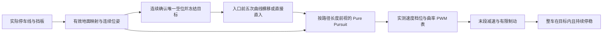

# 路径跟踪停车入库

本次从 GitHub main 的 `cdf8d31` 开发，沿用队友的停车识别和比赛流程。
**仅完成软件修改和离线验证；没有连接、部署或操作车辆。**
本功能用于两个并排半区中“一个遮挡、一个空闲”的低速前进入库，不执行倒车揉库。

## 入口和现有功能

原控制页的“低速停车入位”新增“入库方式”：

- **路径跟踪入库**（页面默认）：使用下述米制路径控制，先连续确认空位和车辆静止，再行驶。
- **原视觉入位试验（对照）**：保留原有像素比例转向、缺框寻位和历史50 cm远黄线制动参考。
  这一路不具备新路径模式的几何保证，不会自动作为新模式的降级策略。

完整比赛流程的 `parking_entry` 使用同一 `ParkingMission` 和 PWM 转换器。
单项完成后仍由操作者进入扫码页面；完整流程在取得入位停稳反馈后进入原有付款阶段，
不更改二维码、付款金额、计时或到账确认语义。

## 控制流程



1. 坐标沿赛道：x向右、y向前、正航向向右，车辆位姿原点为后轴中心。
   两个米制车位始终属于同一世界坐标系，不能每帧随相机重新归零。
2. 已对准车位中线且航向为零时直接生成直线，修复了原来“已经正对入口但因横移距离不足不能进入”的情况。
   需要横移时，生成匹配当前初始航向的五次曲线，入口前完成横移再直入。
   初始偏航超过0.35 rad、距离不足、转弯曲率超限或车身越界时拒绝路径。
3. 对整车矩形外廓校核外侧线、分隔线、遮挡半区和远端线，包含定位误差、净空及离散采样余量。
   目标是车身中心位于半区中部，不能仅让前轮或摄像头进入。
4. 将后轴投影到路径折线，累计进度只前进；沿路径长度取前视目标，再转换到车身坐标。
   曲率为 `2 × 横向目标距离 / 目标距离平方`。使用插值目标，避免按世界y坐标或离散顶点跳选。
5. 随剩余路径与曲率降低目标速度。输出选择不超过目标的已测速度档位；
   不在ESC起步死区内假定PWM与速度线性。曲率按实测表插值，超出表覆盖范围直接停止，不外推。
6. 每帧同时检查当前实际车身、实际转向的停车距离内扫掠区及回中制动方向。
   净空校核针对已知赛道/车位几何，仍依赖有效的路径可见性输入，不能保证避开未被传感器发现的障碍。
7. 到达制动距离时执行原有限 F/B 制动。整车含误差余量在正确半区内、航向偏差不超过0.10 rad、
   测得速度不超过 `stopped_speed_mps`，并持续满足 `stop_hold_s` 后才输出 `parked`。
   目前默认为0.01 m/s和0.5秒，属于软件验收条件，并非已验证的传感器精度。

选中目标后的失帧、位姿异常、控制间隔超限、遮挡变化、轨迹偏离等会锁定停止，
恢复画面不会自行续跑，需要重新准备。仍保留页面0.5秒心跳、独立执行器0.2秒租约、
0.12秒有限F/B制动；没有修改持续遥控500 ms或底层250 ms保护。

## 实车准备所需数据

`vision/configs/parking-bay.json` 中原有尺寸、地面映射、验证标记和制动参数保持。
新增控制参数是软件设置；`motion_calibration.verified` 默认 **false**，
表默认空白，不把测试夹具填入实车配置。有效现场配置仍使用 `parking-bay.local.json`。

需要补齐：

| 数据 | 用途 |
|---|---|
| 固定第二路相机的有效米制映射、近场范围、识别验证 | 车位位置和占用；远近线不可用时不能伪造几何 |
| `minimum_turn_radius_m`、左右当前端点实测半径 | 规划可达性；1350/1610/1870 μs本身不等于车轮角度 |
| `maximum_pose_error_m`、经验证的连续位姿和速度反馈 | 跟踪、误差余量与真实停稳判断 |
| `braking_distance_m` | 在本模式最高速度、实际负载和地面下验证的停车距离上界 |
| `motion_calibration.speed_pwm` | 至少两个有效前进档位，覆盖末段速度至最高速度 |
| `motion_calibration.curvature_pwm` | 左负、右正、中位零曲率的实测表；应量取中间档，不能只按对称端点推算 |
| `motion_calibration.source` | 实测日期、记录路径或记录编号 |

运动表格式：

```json
{
  "verified": false,
  "source": null,
  "speed_pwm": [],
  "curvature_pwm": []
}
```

速度行是 `{"speed_mps": 实测米每秒, "pwm_us": 整数脉宽}`；
曲率行是 `{"curvature_1pm": 带符号的1/实测半径, "pwm_us": 整数脉宽}`。
速度按升序、PWM递增；第一/最后速度必须分别等于配置末段/最高速度。
曲率按升序、PWM递减，必须包含0曲率/1610中位，且只能位于1350–1870 μs内。
速度输出仍限制在1501–1625 μs，不改变既有油门范围。
表最多32行；不要用合成测试表冒充测量。

该阶段沿用现有光流位姿接口，不宣称已经安装编码器。
短暂几何遮挡只允许使用原有、最多2秒的世界车位缓存，且持续位姿和道路可见性必须有效。
新鲜的部分/矛盾布局会清空缓存；需要更长近场遮挡覆盖时必须补充经验证的反馈，不能延长计时盲走。
所有缺项在页面列出；后端也会验证，修改网页按钮无法绕过。

## 日志和复现

- 单项记录：`run/parking-entry-*/settings.json`、`decisions.jsonl`、`summary.json`。
- `intent.parking_decision.tracking` 记录剩余路径、沿路径进度、轨迹误差和目标点。
- `target_speed_mps` 是请求速度；`command_speed_mps` 是本帧选择档位的标定速度；
  两者都不是实时测速，实时速度来自观测 `speed_mps`。
- 单项的“准备侧”只是旧界面建议，路径模式以服务端米制观测确认的空闲侧为准。
- `field_verified` 始终保持false；反馈算出的入位完成不代替现场验收记录。

离线测试（不联网、不打开UART）：

```powershell
$env:PYTHONPATH = "$PWD/vision/src"
python -m pytest vision/tests/test_parking_path.py vision/tests/test_parking_bay.py vision/tests/test_parking_entry_run.py vision/tests/test_race_flow.py -q
python vision/tools/race_flow.py check
```

新增测试用运动学自行车模型积分实际请求的PWM对应曲率和速度，
再将仿真位姿反馈给控制器；没有直接把参考路径点作为“车辆已经到达”的证据。
覆盖左右车位、初始正负偏航、直入、不可达入口、末段减速、扫掠越界、
过期/丢失/跳变反馈、错误遮挡、未停稳、标定表非法、会话与网页模式、执行器白名单。

后续获准部署时使用 `update-race-flow.cmd` 更新完整依赖，并按其既有备份、
差异检查和回滚机制执行。旧的停车单独升级入口会在输出层尚不支持新白名单时拒绝更新，
避免只部署页面却漏掉执行器依赖。本次没有运行任何部署命令。

现场验收建议依次记录：对准直入 → 左侧入口 → 右侧入口 → 接近停点 →
暂时遮挡/停止按钮。每次核对车尾和四轮位置、最大偏差、停稳距离、实际转角及日志原因。
尚未完成的近场、运动标定、供电稳定性与整车入位验收不因软件测试通过而变成已完成。
